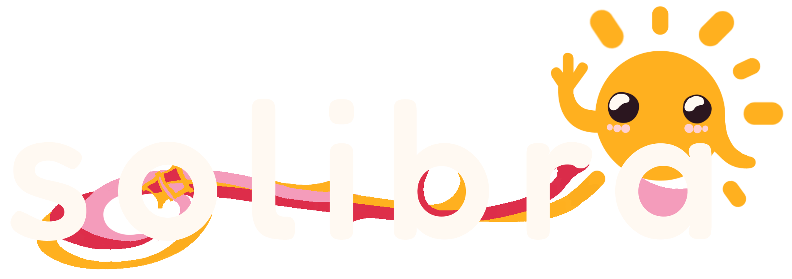

# Solibra

**A little library. A lifetime together.**

*A private, multilingual space for the memories, stories, and voices that connect us.*

[**Explore Solibra**](https://solibra-two.vercel.app/) · [**Visit the demo library**](https://solibra-two.vercel.app/demo) · [**GitHub**](https://github.com/anewshoe/Solibra)



## About Solibra

Some of the most meaningful stories aren't written down. They live in a grandparent's voice, a friend's recollection of the same afternoon, or a photograph whose story only a few people remember.

**Solibra** is a collaborative digital memory library built to give those moments a home. Create private spaces called **Nooks** for your family, friends, or community; collect memories together; and invite others to share their own perspectives. With voice recording, transcription, and translation, stories can be preserved in the language they were told and understood across languages and generations.

Created at **San D Hacks 2026**.

## Features

- **Private Nooks:** Create shared collections for your people, manage members, and accept invitations inside the app.
- **A bookshelf of memories:** Save photographs, written memories, letters, and voice recordings. Browse each Nook through book-shaped keepsakes and pastel-colored shelves.
- **Many points of view:** Add written or recorded perspectives to an existing memory, so one moment can hold more than one person's story.
- **Voices in their original language:** Record and privately store audio, generate a saved transcript with ElevenLabs, and translate it with Gemini into supported languages, including English, Spanish, French, and Telugu.
- **Translations that last:** Return to saved transcripts and translations later, or request another supported translation without recording again.
- **Conversations for each Nook:** Share messages and link memories in a private group conversation.
- **A look inside:** Explore a separate demo library with fictional sample stories, without needing access to anyone's private Nooks.

## How it works

1. **Create a Nook.** Give a shared library a name and invite the people you want to remember with.
2. **Add a memory.** Save a photograph, a written story, a letter, or a voice recording.
3. **Bring in other perspectives.** Members can contribute their own words or recordings to the same memory.
4. **Revisit and understand.** Listen to original voices, read transcripts and translations, and continue the conversation together.

## Built with

| Layer | Technologies |
| --- | --- |
| Application | Next.js, React, TypeScript |
| Interface | Tailwind CSS, Radix UI, shadcn/ui, Lucide, custom Solibra components and artwork |
| Data | PostgreSQL (Neon), Drizzle ORM |
| Authentication | Email/password accounts, bcrypt, JWT session cookies |
| Private media | Neon Object Storage (S3-compatible), authenticated media routes |
| Speech-to-text | ElevenLabs Scribe |
| Translation | Google Gemini |
| Data fetching | SWR |
| Deployment | Vercel |

## Getting started

### Requirements

- Node.js and [pnpm](https://pnpm.io/)
- A PostgreSQL database (or Docker for local PostgreSQL setup)
- Optional, for full photo/audio and AI functionality: private object storage and the respective provider API keys

### 1. Install

```bash
git clone https://github.com/anewshoe/Solibra.git
cd Solibra
pnpm install
```

### 2. Configure the environment

Run the interactive setup script to create `.env`, or configure it manually using `.env.example` as a reference:

```bash
pnpm db:setup
```

At minimum, core account/database functionality uses:

```dotenv
POSTGRES_URL=postgresql://...
DATABASE_URL=postgresql://...
BASE_URL=http://localhost:3000
AUTH_SECRET=your-secret
```

`POSTGRES_URL` is used by the app; `DATABASE_URL` is used by the Drizzle migration configuration. Point both at the **same intended development database** if you run migrations. The setup script creates only the core `.env` fields, so add `DATABASE_URL` and any optional integration keys yourself.

To enable private photo/audio storage and AI features, also configure the relevant server-side variables from `.env.example`:

```dotenv
AWS_ENDPOINT_URL_S3=
AWS_ACCESS_KEY_ID=
AWS_SECRET_ACCESS_KEY=
AWS_REGION=us-east-2
SOLIBRA_MEDIA_BUCKET=solibra-private

ELEVENLABS_API_KEY=
GEMINI_API_KEY=
# GEMINI_TRANSLATION_MODEL=  # optional
```

Keep all credentials private. Browser uploads require CORS permissions for your local/deployed app origin while the storage bucket remains private. See [private media setup](docs/private-media.md) and [persistent voice documentation](docs/persistent-voice.md).

### 3. Prepare the database

Review the existing migrations before applying them, and use a development database rather than resetting or modifying an existing production database:

```bash
pnpm db:migrate
```

### 4. Run Solibra

```bash
pnpm dev
```

Visit [http://localhost:3000](http://localhost:3000). You can also explore the fictional demo at `/demo`.

## Project structure

```text
app/(library)/          Library, Nooks, memories, messages, and demo pages
app/api/nooks/          Authenticated Nook, memory, message, and media routes
components/solibra/    Solibra UI, bookshelves, recording, and playback
lib/memories/           Memory and contribution contracts/services
lib/media/              Private media upload and retrieval
lib/voice/              Speech, translation, and persistence
lib/db/                 Drizzle schema, queries, and migrations
docs/                   Integration and implementation details
tests/                  Automated regression tests
```

## Development checks

```bash
pnpm exec tsc --noEmit
node --test tests/*.test.cjs
pnpm build
```

Some workflows require a configured database, storage bucket, and provider credentials. Automated mocks do not replace testing the complete browser recording/upload/translation flow against a development environment.

## Privacy and project notes

- Real Nooks, memories, messages, and saved media are scoped to authenticated membership. Demo content is separate and fictional.
- Audio is stored privately and served through authenticated application routes; storage keys are not public download links.
- Inviting someone creates an **in-app invitation**; Solibra does not currently send invitation emails.
- Processing and translation depend on configured third-party services, their quotas, and network availability.
- Solibra is a hackathon project and an evolving prototype, not an end-to-end encrypted archival service.

## Acknowledgments and attribution

Built for **San D Hacks 2026**, with a focus on preserving the small moments that make people feel close—even across languages and generations.

Some initial authentication and database scaffolding was adapted from [Vercel's Next.js SaaS Starter](https://github.com/nextjs/saas-starter), which is MIT-licensed. Solibra's library experience, Nooks, memory features, multilingual voice workflows, and visual identity were developed for this project. See [third-party notices](THIRD_PARTY_NOTICES.md) for the retained upstream copyright and license notice.
